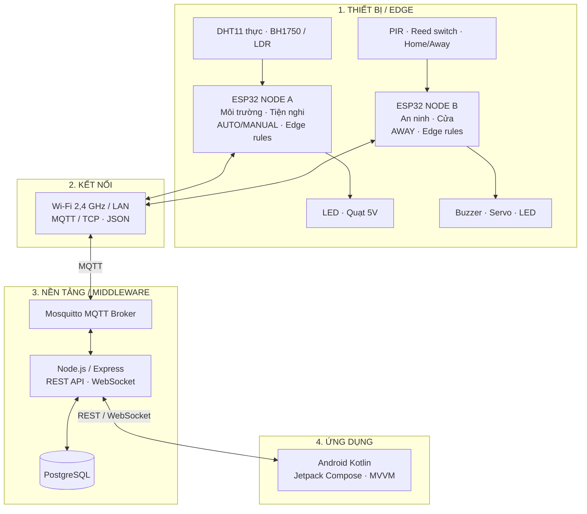

# Hệ thống nhà thông minh IoT với ESP32 và Android Kotlin

> **Đề tài của Nhóm 9:** Giám sát môi trường, điều khiển thiết bị và tự động hóa cục bộ bằng ESP32, MQTT và ứng dụng Android.
>
> **Trạng thái:** Đang trong giai đoạn phân tích, thiết kế và phát triển. Các chức năng, công nghệ và chỉ tiêu bên dưới là **kế hoạch dự kiến**, chưa phải thông báo rằng hệ thống đã được triển khai hoàn chỉnh.

> **Cảnh báo chuyển đổi kiến trúc (`LEGACY` vs ThingsBoard `DRAFT`):**
>
> Các mô tả dùng **Mosquitto + Node.js/Express + 12 custom topic `smarthome/v1/{device_id}/...`** trong tài liệu này và [contracts/mqtt-v1.md](contracts/mqtt-v1.md) là kiến trúc **`LEGACY / REFERENCE`** để đối chiếu ngữ nghĩa dữ liệu lịch sử, **không còn là mặc định đã chốt** cho hướng tích hợp mới. Nhóm đang đề xuất chuyển sang **ThingsBoard Device Provisioning** và **ThingsBoard built-in MQTT API** (`v1/devices/me/telemetry`, `v1/devices/me/attributes`, `v1/devices/me/rpc/request/+`, không tương thích trực tiếp trên wire với `smarthome/v1/...`), tuy nhiên đặc tả [contracts/thingsboard-v1.md](contracts/thingsboard-v1.md) hiện ở trạng thái **`DRAFT / PROPOSED`** và toàn bộ quyết định **`TB-DEC-01`..`TB-DEC-09`** vẫn **`OPEN`** (chưa được nhóm phê duyệt; xem thêm [docs/HANDOFF_BACKEND_ANDROID.md](docs/HANDOFF_BACKEND_ANDROID.md)).
>
> **Hiện trạng firmware thực tế:** Source Node A/Node B mới hoàn thiện lớp cảm biến, actuator, edge rules (`AUTO`/`MANUAL`, `HOME`/`AWAY`), `CommandGuard`, `UtcParser`, `WiFiConnectionManager` (non-blocking STA) và bounded offline RAM queues; **chưa triển khai hoặc runtime-verify** MQTT client, ThingsBoard provisioning, TLS, SNTP, JSON transport, live telemetry/RPC và lưu trữ credential NVS. Cả hai bản `REAL` hiện **`UNCONFIGURED` về Wi-Fi** (không chứa credential thật trong repo); edge rules vẫn chạy độc lập offline ở mức source/unit-test/build, còn **runtime trên Wokwi và ESP32 thật hiện chưa được xác minh (`NOT_VERIFIED`)**.

## 1. Giới thiệu

Dự án hướng tới xây dựng một hệ thống nhà thông minh cho phép người dùng theo dõi các thông số môi trường, quan sát trạng thái thiết bị và điều khiển các cơ cấu chấp hành bằng điện thoại Android.

Hệ thống sử dụng các nút **ESP32** để thu thập dữ liệu cảm biến và trao đổi bản tin **MQTT** với một hệ thống trung gian gồm **Mosquitto MQTT Broker**, **Node.js/Express** và **PostgreSQL**. Ứng dụng **Android viết bằng Kotlin** cung cấp giao diện giám sát và điều khiển. **Node A sẽ sử dụng DHT11 có sẵn** để đo nhiệt độ/độ ẩm; đây là điều chỉnh thực tế so với phương án cảm biến ghi trong đề cương BT02.

Điểm nhấn của đề tài là **tự động hóa cục bộ (edge rules)**: ESP32 có thể xử lý một số quy tắc ngay trên thiết bị để tiếp tục phản ứng với điều kiện cảm biến khi kết nối đến backend hoặc Internet bị gián đoạn.

Tài liệu định hướng chung: [Báo cáo BT02 – Đề cương thuyết minh chi tiết đề tài](docs/Bao_cao_BT02_IoT.docx). **Kế hoạch phần cứng/firmware chi tiết**: [docs/PLAN_PHAN_CUNG_FIRMWARE.md](docs/PLAN_PHAN_CUNG_FIRMWARE.md).

## 2. Mục tiêu và đối tượng sử dụng

- **Thành viên gia đình:** Xem nhiệt độ, độ ẩm, độ sáng, trạng thái cửa và điều khiển đèn/quạt trên điện thoại.
- **Chủ nhà / quản trị viên:** Chuyển chế độ **Home/Away**, cấu hình ngưỡng tự động, xem lịch sử dữ liệu và nhận cảnh báo an ninh.
- **Mục tiêu kỹ thuật:** Kết nối cảm biến – ESP32 – MQTT – backend – ứng dụng; hỗ trợ phản hồi trạng thái, lưu lịch sử và tự kết nối lại sau gián đoạn mạng.

## 3. Chức năng dự kiến

| Nhóm chức năng | Mô tả |
| --- | --- |
| Thu thập dữ liệu | Đọc **nhiệt độ, độ ẩm, độ sáng, chuyển động và trạng thái đóng/mở cửa** từ các cảm biến. |
| Giám sát | Hiển thị dữ liệu gần thời gian thực và trạng thái **online/offline** của các nút ESP32 trên Android. |
| Điều khiển từ xa | Bật/tắt hoặc điều khiển **LED, quạt mini, servo, buzzer** qua ứng dụng và nhận phản hồi trạng thái. |
| Tự động hóa cục bộ | Thực thi **edge rules** trên ESP32, không phụ thuộc hoàn toàn vào backend. |
| Chế độ an ninh | Hỗ trợ **Home/Away**; phát cảnh báo khi cửa mở trong chế độ **Away**. |
| Lịch sử và thống kê | Lưu dữ liệu cảm biến, trạng thái thiết bị; truy vấn theo khoảng thời gian qua API. |
| Phục hồi kết nối | Tự kết nối lại **Wi-Fi/MQTT** sau khi Access Point hoặc broker hoạt động trở lại. |
| Xác thực và hiển thị | Dự kiến xác thực thiết bị, kiểm soát truy cập và trực quan hóa dữ liệu trên ứng dụng. |

## 4. Kiến trúc hệ thống dự kiến

Hệ thống gồm bốn lớp **thiết bị/edge – mạng/kết nối – nền tảng/middleware – ứng dụng**. Hai nút ESP32 được tách theo chức năng để firmware phát triển độc lập; chúng trao đổi dữ liệu qua MQTT broker, **không cần nối dây trực tiếp với nhau**.



**Phân chia phần cứng:**

| Node | Đầu vào | Đầu ra | Hoạt động tự động cục bộ |
| --- | --- | --- | --- |
| **Node A – Môi trường** | **DHT11 thật**, BH1750 thật / LDR mô phỏng; **DHT22 chỉ thay thế mô phỏng Wokwi** | LED, quạt 5V qua MOSFET | Bật/tắt đèn/quạt theo ngưỡng có hysteresis; Auto/Manual |
| **Node B – An ninh** | PIR, reed switch, công tắc Home/Away dự kiến | Buzzer, servo SG90, LED trạng thái | Cảnh báo khi cửa mở trong Away ngay cả khi broker không hoạt động |

**Luồng chính:** ESP32 → MQTT → Node.js/PostgreSQL → ứng dụng để giám sát; ứng dụng → API → MQTT → ESP32 để điều khiển và nhận **trạng thái thực tế** sau thực thi. Khi mất broker/backend, quy tắc cục bộ của từng ESP32 vẫn hoạt động; thông báo từ xa có thể bị gián đoạn.

**Phạm vi MVP:** Wi-Fi 2,4 GHz, router/AP trong nhà; không yêu cầu gateway Zigbee/Thread. Phân chia node, chân GPIO, vật tư và trạng thái thiết kế xem [**Kế hoạch phần cứng & firmware – Phạm Ngọc Hưng**](docs/PLAN_PHAN_CUNG_FIRMWARE.md).

## 5. Công nghệ dự kiến

| Thành phần | Công nghệ / công cụ |
| --- | --- |
| Vi điều khiển | **2 ESP32 DevKit**: Node A môi trường, Node B an ninh |
| Kết nối thiết bị | **Wi-Fi 2,4 GHz**, **MQTT/TCP**, payload **JSON** |
| Firmware và mô phỏng | **PlatformIO (Arduino C++)**, **Wokwi**; Antigravity dùng để phát triển code (tùy tương thích extension) |
| MQTT broker | **Eclipse Mosquitto** |
| Backend | **Node.js**, **Express**, REST API, **WebSocket** |
| Cơ sở dữ liệu | **PostgreSQL** |
| Ứng dụng Android | **Kotlin**, **Jetpack Compose**, **MVVM**, Repository, Retrofit/OkHttp, WebSocket |
| Triển khai | Dự kiến sử dụng **Docker Compose** cho các dịch vụ backend |
| Bảo mật theo thiết kế | Phân quyền/JWT cho API, xác thực MQTT; cân nhắc **TLS/MQTTS** khi truy cập qua Internet, lưu bí mật ngoài mã nguồn |

Các thành phần trên được xác định trong đề cương, **không có nghĩa là toàn bộ đã được cài đặt hoặc tích hợp**.

## 6. Phần cứng và kinh phí

BOM gốc được xác định trong BT02. **Điều chỉnh quan trọng:** BT02 đề xuất SHT31 hoặc DHT22, nhưng mảng firmware đã chọn **DHT11 có sẵn**, không mua DHT22 cho phần cứng thật. Các linh kiện khác giữ theo hướng đã thảo luận, ưu tiên **MOSFET** để điều khiển quạt 5V.

| Linh kiện | Số lượng | Vai trò |
| --- | ---: | --- |
| ESP32 DevKit (ESP-WROOM-32) | 2 | Node A và Node B |
| **DHT11 có sẵn** (kiểm tra bản 3/4 chân) | 1 | Đo nhiệt độ, độ ẩm trên Node A; không cần mua DHT22 |
| BH1750 GY-302 | 1 | Đo độ sáng I2C |
| PIR HC-SR501 | 1 | Phát hiện chuyển động |
| Reed switch + nam châm | 1 bộ | Trạng thái cửa |
| LED, quạt DC 5V, buzzer, SG90 | 1 bộ | Đèn/quạt/cảnh báo/mô hình cửa |
| MOSFET driver tương thích GPIO 3,3V | 1 | Điều khiển quạt; relay là phương án khác hoặc bổ sung tùy nhu cầu |
| Breadboard, dây, nguồn 5V | 1 bộ | Lắp ráp và cấp nguồn |

**Vật tư phụ trợ cần chuẩn bị theo kế hoạch firmware:** hai breadboard (mỗi node một chiếc), 2 cáp USB truyền dữ liệu, dây jumper đủ kiểu đầu, điện trở 220–330Ω và 10kΩ, công tắc Home/Away, nguồn 5V đủ dòng cho tải, đồng hồ vạn năng và linh kiện dự phòng. Các khoản bổ sung **chưa có báo giá xác nhận**.

**Dự toán gốc BT02: khoảng 555.000–850.000 VNĐ** cho danh mục BT02 (gồm SHT31/DHT22), không tính laptop/router/điện thoại. Vì **DHT11 đã có sẵn** và một số vật tư phụ cần bổ sung nên tổng mua thực tế có thể khác; chưa có báo giá mới. Không sử dụng điện lưới 220V trên breadboard.

**Tương ứng Wokwi:** Wokwi hiện có **DHT22 nhưng không liệt kê DHT11 trong danh mục chuẩn**. Khi mô phỏng dùng **DHT22 thay thế DHT11 ở tầng đọc cảm biến**, **LDR thay BH1750**, **slide switch thay reed switch**, **LED/PWM thay quạt**. Firmware thật phải cấu hình driver **DHT11**, firmware mô phỏng phải cấu hình driver **DHT22** hoặc nguồn dữ liệu mock; **mô phỏng DHT22 không thay cho kiểm thử DHT11 thật**. PIR, LED, buzzer, servo có linh kiện mô phỏng.

**Lưu ý DHT11:** Sensor này có dải nhiệt độ tham khảo 0–50°C (sai số khoảng ±2°C), độ ẩm khoảng 20–80% RH (sai số khoảng ±5% RH); phù hợp demo nhà thông minh nhưng không phải thiết bị đo chính xác cao. Nên đọc cách nhau **ít nhất 2 giây** và publish MQTT độc lập theo chu kỳ đã chốt (ví dụ 5 giây). Cần kiểm tra thứ tự chân của module đang có; DATA kéo lên mức **3,3V**, không đưa 5V vào GPIO ESP32.

BOM chi tiết, bảng GPIO, quy tắc cấp nguồn, phân biệt driver DHT11 thật/DHT22 mô phỏng và hướng dẫn kiểm tra trước khi nối mạch: [docs/PLAN_PHAN_CUNG_FIRMWARE.md](docs/PLAN_PHAN_CUNG_FIRMWARE.md).

## 7. Kế hoạch kiểm thử và nghiệm thu

Các trường hợp kiểm thử được đề xuất trong báo cáo BT02:

- **Cảm biến:** Tác động lên từng cảm biến và đối chiếu dữ liệu trên Serial log, MQTT broker và ứng dụng Android.
- **Điều khiển:** Thử **20 lần gửi lệnh** từ ứng dụng, ghi nhận việc thực thi và phản hồi trạng thái.
- **Edge rules:** Ngắt backend/Internet, kích hoạt điều kiện cảm biến và kiểm tra ESP32 vẫn thực hiện tác vụ cục bộ.
- **An ninh:** Chuyển sang **Away**, mô phỏng mở cửa bằng reed switch và kiểm tra cảnh báo.
- **Lịch sử:** Gọi API lấy dữ liệu theo khoảng thời gian và so sánh với dữ liệu trong PostgreSQL.
- **Reconnect:** Tắt/bật Access Point hoặc broker, thử **5 lần**, đo thời gian tự khôi phục Wi-Fi/MQTT.
- **Hoạt động dài hạn:** Theo dõi uptime, reconnect, lỗi kết nối/bộ nhớ; thử nghiệm vận hành **24 giờ** theo phần nghiệm thu trong đề cương.
- **Xác thực và trực quan hóa:** Kiểm tra quyền của thiết bị tham gia hệ thống, cách hiển thị dữ liệu và sự tương ứng với dữ liệu gốc.

**Các chỉ tiêu cần nhóm chốt thêm:** Mức độ trễ điều khiển tối đa, chu kỳ gửi telemetry, thời gian phục hồi kết nối, thời gian vận hành liên tục mục tiêu và số ngày lưu trữ tối thiểu. Bản đề cương hiện còn để trống các giá trị này; không tự suy ra thành cam kết. Riêng phép đo trễ dự kiến yêu cầu **ít nhất 95% trong 20 lần thử** đạt ngưỡng sẽ thống nhất.

## 8. Phân công Nhóm 9

| Thành viên | Phụ trách | Sản phẩm dự kiến |
| --- | --- | --- |
| **Phạm Ngọc Hưng** | Firmware ESP32, phần cứng và tích hợp | Sơ đồ đấu nối, BOM, đọc cảm biến, điều khiển actuator, reconnect, edge rules, tích hợp và kiểm thử end-to-end |
| **Khương Anh Tài** | Backend, cơ sở dữ liệu và triển khai | Mosquitto, Node.js/Express, REST API/WebSocket, thiết kế PostgreSQL, `docker-compose.yml` |
| **Bùi Trung Hoàng** | Ứng dụng Android, kiểm thử và tài liệu | Kotlin/Jetpack Compose/MVVM; Dashboard, Control, History, Alarm; kế hoạch kiểm thử, video demo và báo cáo |

## 9. Tài liệu trong repository

```text
IoT/
├── README.md
└── docs/
    ├── Bao_cao_BT01_IoT_Lumi_Smart_Home.docx
    ├── Bao_cao_BT02_IoT.docx
    ├── PhamNgocHung.pdf
    └── PLAN_PHAN_CUNG_FIRMWARE.md
```

- [**BT02 – Đề cương thuyết minh chi tiết đề tài**](docs/Bao_cao_BT02_IoT.docx): **nguồn gốc** của yêu cầu, kiến trúc chung, vật tư và phân công Nhóm 9.
- [**Kế hoạch phần cứng & firmware ESP32 – Phạm Ngọc Hưng**](docs/PLAN_PHAN_CUNG_FIRMWARE.md): tài liệu triển khai **riêng mảng thiết bị**; có BOM mở rộng, hai node, pinout, Wokwi/PlatformIO, hợp đồng MQTT **đề xuất**, an toàn điện và quy trình kiểm thử.
- [BT01 – IoT Lumi Smart Home](docs/Bao_cao_BT01_IoT_Lumi_Smart_Home.docx): tài liệu tham khảo của nhóm.
- [PhamNgocHung.pdf](docs/PhamNgocHung.pdf): tài liệu bổ sung có sẵn.

**Hiện tại chưa có mã firmware/backend/Android trong repository.** Các thư mục mã nguồn mô tả trong file plan chỉ là cấu trúc **đề xuất** để Gemini/nhóm triển khai sau, không phải các thư mục đã tồn tại.

## 10. Hướng triển khai và kiểm chứng

Kế hoạch phát triển chia thành các chặng: **(1)** nạp ESP32 và Serial Monitor; **(2)** hoàn thiện **DHT11 thật** và BH1750 cho Node A (Wokwi dùng DHT22/LDR thay thế); **(3)** kết nối Mosquitto/MQTT; **(4)** điều khiển LED/quạt và edge rules; **(5)** hoàn thiện Node B với PIR/reed/buzzer/servo; **(6)** tích hợp backend–Android; **(7)** kiểm thử hệ thống và thu thập bằng chứng.

Không đồng nhất **đã viết code**, **mô phỏng chạy** và **phần cứng thật đã nghiệm thu**. Theo BT02, dự kiến thử 20 lệnh điều khiển, 5 lần gián đoạn mạng, cảnh báo Away và hoạt động edge khi mất backend. Các ngưỡng độ trễ/chu kỳ truyền/reconnect và mục tiêu lưu trữ trong BT02 còn cần nhóm chốt; những con số trong file plan chỉ là đề xuất để thảo luận.

Hướng dẫn phần việc của người lập trình firmware, hợp đồng MQTT cần gửi cho backend và nguyên tắc review code với Antigravity/Gemini: [**Kế hoạch phần cứng & firmware**](docs/PLAN_PHAN_CUNG_FIRMWARE.md).

---

*README tổng quan dựa trên BT02 của Nhóm 9; phần cứng và firmware được cụ thể hóa trong kế hoạch riêng do Phạm Ngọc Hưng phụ trách. Tham khảo tài liệu Wokwi, PlatformIO và Espressif được dẫn trong file plan.*
"# iot" 
