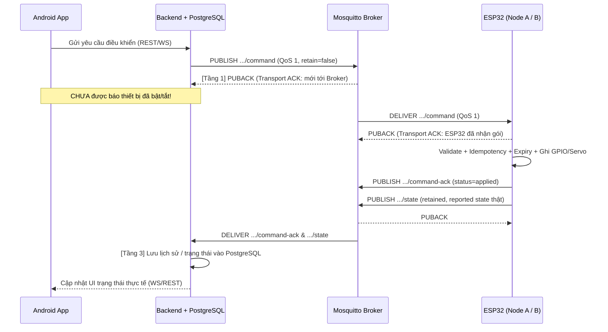

# Hợp đồng giao tiếp MQTT v1 (Node A & Node B)

> **THÔNG BÁO CHUYỂN ĐỔI KIẾN TRÚC (LEGACY / KHÔNG CÒN MẶC ĐỊNH CHO THINGSBOARD):**  
> Đặc tả custom MQTT (`smarthome/v1/{device_id}/...`, X.509 client certificates mTLS và Mosquitto ACL) dưới đây là **tài liệu tham chiếu lịch sử (legacy)** theo kiến trúc Mosquitto + Node.js cũ và **chưa áp dụng trực tiếp cho ThingsBoard**.  
> Nhóm đang chuyển sang **ThingsBoard Device Provisioning** (`provisionDeviceKey` / `provisionDeviceSecret`) và **ThingsBoard MQTT API**. Vui lòng xem bản nháp đặc tả chuyển đổi tại **[contracts/thingsboard-v1.md](thingsboard-v1.md)** (`DRAFT / PROPOSED`). Toàn bộ nội dung lịch sử bên dưới và bộ 20 file mẫu trong [contracts/examples/](examples/) được giữ nguyên để đối chiếu ngữ nghĩa payload, biên an toàn và các test vector nội bộ.

> **Trạng thái tài liệu:** Bản đặc tả hợp đồng giao tiếp cho nhánh **Thiết bị / Firmware ESP32** (`node-a`, `node-b`), làm cơ sở tích hợp với **Backend (Node.js/Mosquitto/PostgreSQL)** và **Android Kotlin**.  
> **Các mục gắn nhãn `[PROPOSED]`** là phần đề xuất mở rộng hoặc chi tiết cần **Khương Anh Tài (Backend)** và **Bùi Trung Hoàng (Android)** rà soát và phê duyệt trước khi đóng băng triển khai chéo nhóm. Tài liệu này **không định nghĩa REST API hay schema SQL** của Backend.  
> **Tài liệu tham chiếu gốc:** [README.md](../README.md), [docs/PLAN_PHAN_CUNG_FIRMWARE.md](../docs/PLAN_PHAN_CUNG_FIRMWARE.md), [docs/Bao_cao_BT02_IoT.docx](../docs/Bao_cao_BT02_IoT.docx).

---

## 1. Kiến trúc tổng thể & Nguồn chân lý duy nhất (SSOT)

### 1.1. Mô hình kết nối hai ESP32 độc lập
- **Hai MQTT client độc lập:** `node-a` (`firmware/node-environment`) và `node-b` (`firmware/node-security`) kết nối trực tiếp tới **Mosquitto MQTT Broker** qua Wi-Fi 2,4 GHz.
- **Không dùng Gateway trung gian:** Hai node không giao tiếp trực tiếp với nhau qua dây hoặc ESP-NOW, không sử dụng một node làm gateway cho node còn lại. Mọi tương tác chéo (nếu có trong tương lai) phải đi qua Broker/Backend theo ACL hợp lệ.
- **Tách môi trường `REAL` và `SIM`:**
  - `node-a` (`role: "environment"`): `REAL` dùng `DHT11` + `BH1750` + LED + Quạt 5V (MOSFET); `SIM` (Wokwi) dùng `DHT22` + `LDR` + LED + PWM/LED mô phỏng quạt. *(Ghi chú: [PLAN_PHAN_CUNG_FIRMWARE.md](../docs/PLAN_PHAN_CUNG_FIRMWARE.md) trước đây ghi `DHT22` cho cả mạch thật; hợp đồng v1 hỗ trợ cả hai giá trị `temp_hum_source` là `"DHT11"` và `"DHT22"` để đồng bộ với thực tế phần cứng Node A dùng `DHT11` thật).*
  - `node-b` (`role: "security"`): `REAL` dùng `PIR_HC_SR501` + `REED_SWITCH` + `HOME_AWAY_SWITCH` + `BUZZER` + `SG90`; `SIM` (Wokwi) dùng `PIR` + `SLIDE_SWITCH_REED_SIM` + `BUZZER` + `SERVO`.

### 1.2. Chính sách SSOT (Single Source of Truth)
| Miền dữ liệu | Nguồn chân lý (SSOT) | Vai trò và giới hạn |
| --- | --- | --- |
| **Device Registry & Topology** (`device_id` hợp lệ, trạng thái `active`/`revoked`, gán phòng/hệ thống, mapping chứng chỉ) | **Backend + PostgreSQL** | Node **không** tự đăng ký vào hệ thống. Node chỉ gửi `meta` để khai báo năng lực phần cứng sau khi đã có quyền. |
| **Chính sách / Ngưỡng cấu hình dài hạn** | **Backend** (bản gốc cấu hình) + **ESP32** (bản sao đang áp dụng cục bộ) | Khi mất mạng, ESP32 dùng cấu hình hợp lệ gần nhất đang lưu cục bộ. |
| **Trạng thái thực tế thiết bị (`reported state`)** (`lamp_on`, `fan_on`, `device_mode`, `security_mode`, `door_open`, `alarm_on`, `servo_angle`) | **Chính từng ESP32** (`node-a` / `node-b`) | Chỉ bản tin `state` / `command-ack` do ESP32 phát ra mới phản ánh trạng thái phần cứng thật. App/Backend không tự suy đoán trạng thái đã đổi khi mới publish `command`. |
| **Lịch sử telemetry / event (≥ 7 ngày)** | **Backend + PostgreSQL** | ESP32 chỉ giữ ring-buffer ngắn hạn trong RAM khi mất kết nối, không lưu trữ lịch sử dài hạn. |

---

## 2. Bảo mật X.509 mTLS, ACL & Chống node lạ gia nhập topology

### 2.1. Chính sách môi trường `REAL` (LAN / Production)
1. **Transport & Xác thực hai chiều (mTLS):**
   - Kết nối qua **TLS 1.2+ (khuyến nghị cổng `8883`)**, bật xác thực server certificate lẫn client certificate (`require_certificate true` trên Mosquitto).
   - **Cấm tuyệt đối `setInsecure()`** trong code biên dịch `REAL`. Firmware phải xác minh chuỗi tin cậy của server certificate bằng **CA Root Certificate** được nhúng/nạp sẵn và kiểm tra hostname/SAN khớp địa chỉ Broker.
   - **Cấp phát khóa riêng từng node:** `node-a` và `node-b` sở hữu cặp `(client_cert, private_key)` **riêng biệt**, nạp vào vùng lưu trữ ngoài mã nguồn (ví dụ NVS/LittleFS partition hoặc file bí mật bị `.gitignore` chặn). Cấm dùng chung một chứng chỉ cho nhiều thiết bị; cấm hardcode private key, mật khẩu Wi-Fi hay chuỗi bí mật trong source code hoặc repo Git.
   - **Đồng hồ TLS:** Xác minh thời hạn (`notBefore`/`notAfter`) của X.509 certificate đòi hỏi thời gian hệ thống tin cậy (SNTP hoặc RTC). Khi node mới khởi động chưa có NTP, cần có lộ trình đồng bộ thời gian trước hoặc chính sách kiểm chứng thời hạn chứng chỉ rõ ràng khi thiết kế tầng kết nối `[PROPOSED]`.
2. **Mapping chứng chỉ sang Device Identity:**
   - Mosquitto bật ánh xạ danh tính từ chứng chỉ (`use_identity_as_username true` từ trường `Common Name (CN)` hoặc `SAN`).
   - Quy ước đặt `CN` trùng khớp 1-1 với `device_id`: `CN=node-a` cho Node A, `CN=node-b` cho Node B, và `CN=backend-service` (hoặc tài khoản dịch vụ riêng) cho Backend.
   - MQTT `ClientId` khuyến nghị đặt bằng `device_id` (`"node-a"`, `"node-b"`).
   - **Đối soát chéo tại Broker & Backend:** `authenticated_identity` (từ chứng chỉ TLS) == `topic.device_id` == `payload.device_id`. Bất kỳ sai lệch nào đều phải từ chối/drop bản tin và ghi log cảnh báo bảo mật.
3. **Phân quyền ACL theo danh tính (Least Privilege):**
   - **`node-a` (`CN=node-a`):**
     - `write`: `smarthome/v1/node-a/telemetry`, `smarthome/v1/node-a/command-ack`, `smarthome/v1/node-a/state`, `smarthome/v1/node-a/status`, `smarthome/v1/node-a/meta`
     - `read`: `smarthome/v1/node-a/command`
     - **Cấm:** Mọi quyền đọc/ghi sang `smarthome/v1/node-b/#` hoặc wildcard `#`, `+`.
   - **`node-b` (`CN=node-b`):**
     - `write`: `smarthome/v1/node-b/event`, `smarthome/v1/node-b/command-ack`, `smarthome/v1/node-b/state`, `smarthome/v1/node-b/status`, `smarthome/v1/node-b/meta`
     - `read`: `smarthome/v1/node-b/command`
     - **Cấm:** Mọi quyền đọc/ghi sang `smarthome/v1/node-a/#` hoặc wildcard `#`, `+`.
   - **`backend-service`:** `read` các topic `telemetry`, `event`, `command-ack`, `state`, `status`, `meta` của tất cả node hợp lệ; `write` vào `smarthome/v1/+/command`.
4. **Chống node lạ tự tham gia topology (Pre-provisioning Gate):**
   - **Nguyên tắc bắt buộc:** Một chứng chỉ X.509 hợp lệ (do nội bộ CA ký đúng) **KHÔNG tự động cấp quyền đăng ký thiết bị mới hay gia nhập topology**.
   - Trước khi thiết bị được phép trao đổi nghiệp vụ:
     1. Quản trị viên phải **khai báo trước (`pre-register`)** `device_id` và vân tay/serial chứng chỉ trong Device Registry của Backend (`status = "active"`).
     2. Mosquitto ACL chỉ cấp quyền topic cho các `CN` đã duyệt.
     3. Nếu nhận bản tin (kể cả `meta`) từ `device_id` chưa tồn tại trong Registry hoặc đã bị đánh dấu `revoked`, Backend phải **từ chối lưu/bỏ qua và gắn cảnh báo an ninh**, không tự động tạo thiết bị mới hay hiển thị lên App Android.
     4. Khi nghi ngờ lộ private key của một node, thu hồi chứng chỉ trên CA/CRL, gỡ `CN` khỏi Mosquitto ACL và chuyển trạng thái thiết bị trong Backend sang `revoked`.

### 2.2. Chính sách môi trường `SIM` / Mock Test cục bộ
- Trong kiểm thử Wokwi hoặc mock broker nội bộ (`127.0.0.1`), không bao giờ dùng CA hoặc private key thật của `REAL`.
- `[PROPOSED]` Hai phương án triển khai cho `SIM` cần thống nhất với Backend trước khi tích hợp:
  - **Phương án 1 (Khuyến nghị):** Lab test CA tự ký riêng cho `SIM` (chỉ dùng chứng chỉ test không có giá trị ngoài lab, vẫn giữ nguyên đường code xác minh chứng chỉ server, **không dùng `setInsecure()`**).
  - **Phương án 2 (Mock nội bộ):** Dùng plain TCP/username-password chỉ giới hạn trên loopback `127.0.0.1` / mạng lab cô lập khi công cụ mô phỏng chưa hỗ trợ nạp CA/key hoặc cần kiểm thử nhanh logic MQTT; vẫn cấm dùng `setInsecure()` trong bản build `REAL`.
- Với Wokwi chạy trên PC: Wokwi Public Gateway không truy cập trực tiếp `localhost` của máy phát triển; cần Wokwi Private IoT Gateway (`host.wokwi.internal`) hoặc broker test cô lập có xác thực. Không mở broker công khai không xác thực.

---

## 3. Danh mục Topic v1

Tiền tố chung: `smarthome/v1/{device_id}/...` với `device_id` ∈ `{"node-a", "node-b"}`.

| Node | Topic đầy đủ | Hướng | QoS | Retain | Mục đích & Ghi chú |
| --- | --- | --- | :---: | :---: | --- |
| `node-a` | `smarthome/v1/node-a/telemetry` | Node A → Broker/Backend | `1` | `false` | Dữ liệu cảm biến nhiệt độ, độ ẩm, ánh sáng định kỳ (5s/lần) và mẫu backfill. |
| `node-a` | `smarthome/v1/node-a/command` | Backend → Node A | `1` | `false` | Lệnh điều khiển đèn, quạt, `AUTO`/`MANUAL`, `[PROPOSED]` cấu hình ngưỡng. **Cấm retain.** |
| `node-a` | `smarthome/v1/node-a/command-ack` | Node A → Backend | `1` | `false` | `[PROPOSED]` Kết quả xử lý lệnh theo `command_id` (`applied`/`rejected`/`expired`/`duplicate`). |
| `node-a` | `smarthome/v1/node-a/state` | Node A → Backend/App | `1` | `true` | Trạng thái thực tế hiện tại (`lamp_on`, `fan_on`, `device_mode`, ngưỡng đang dùng). |
| `node-a` | `smarthome/v1/node-a/status` | Node A / LWT → Backend/App | `1` | `true` | Trạng thái kết nối `online` / `offline` (LWT khi rớt mạng đột ngột). |
| `node-a` | `smarthome/v1/node-a/meta` | Node A → Backend | `1` | `true` `[PROPOSED]` | `[PROPOSED]` Khai báo metadata phần cứng, firmware, capabilities; không thay thế registry. |
| `node-b` | `smarthome/v1/node-b/event` | Node B → Broker/Backend | `1` | `false` | Sự kiện tức thời (≤1s): đóng/mở cửa, chuyển động PIR, kích/tắt báo động, đổi mode cục bộ. |
| `node-b` | `smarthome/v1/node-b/command` | Backend → Node B | `1` | `false` | Lệnh đặt `HOME`/`AWAY`, góc `servo`, tắt/kiểm tra báo động. **Cấm retain.** |
| `node-b` | `smarthome/v1/node-b/command-ack` | Node B → Backend | `1` | `false` | `[PROPOSED]` Kết quả xử lý lệnh theo `command_id`. |
| `node-b` | `smarthome/v1/node-b/state` | Node B → Backend/App | `1` | `true` | Trạng thái thực tế hiện tại (`security_mode`, `door_open`, `motion_detected`, `alarm_on`, `servo_angle`). |
| `node-b` | `smarthome/v1/node-b/status` | Node B / LWT → Backend/App | `1` | `true` | Trạng thái kết nối `online` / `offline` (LWT). |
| `node-b` | `smarthome/v1/node-b/meta` | Node B → Backend | `1` | `true` `[PROPOSED]` | `[PROPOSED]` Khai báo metadata phần cứng, firmware, capabilities; không thay thế registry. |

---

## 4. Quy chuẩn Envelope & Kiểu dữ liệu dùng chung

### 4.1. Các trường bắt buộc và quy ước chung
| Trường | Kiểu | Áp dụng | Quy định chuẩn |
| --- | --- | --- | --- |
| `schema_version` | `integer` | Tất cả bản tin | Cố định `1`. Phiên bản khác `1` phải bị từ chối rõ ràng. |
| `device_id` | `string` | Tất cả bản tin | `"node-a"` hoặc `"node-b"`. Bắt buộc trùng với `{device_id}` trong topic và identity chứng chỉ. |
| `boot_id` | `string` | `telemetry`, `event`, `state`, `command-ack`, `status` (online), `meta` | Chuỗi định danh duy nhất cho **mỗi lần MCU khởi động/reset** (ví dụ `"boot-<n>-<hex8>"` dùng bộ đếm boot lưu NVS hoặc số ngẫu nhiên phần cứng `esp_random()`). Không dùng giá trị tĩnh lặp lại qua các lần reboot. *(Riêng bản tin LWT `offline` đăng ký trước khi kết nối mang `boot_id` của phiên kết nối đó).* |
| `seq` | `integer` (≥ 1) | `telemetry`, `event`, `state`, `command-ack`, `meta` | Số thứ tự tăng đơn điệu trong phạm vi một `boot_id`. Khuyến nghị tăng liên tục trong phiên boot (hoặc theo từng stream) để phát hiện mất gói và chống trùng lặp khi QoS 1 truyền lại. |
| `command_id` | `string` | `command`, `command-ack`, tùy chọn `last_command_id` trong `state` | Định danh duy nhất cho mỗi lệnh từ Backend/App (UUID/ULID/chuỗi định danh không trùng, 8–64 ký tự `[A-Za-z0-9_-]`). |
| `mode` / `device_mode` / `security_mode` | `string` | `command`, `state`, `event` | Node A dùng `device_mode` ∈ `{"AUTO", "MANUAL"}`. Node B dùng `security_mode` ∈ `{"HOME", "AWAY"}`. Trong bản tin `command` cho phép mang `mode` hoặc trường đích cụ thể theo đặc tả mục 5. |
| `timestamp` | `string \| null` | Tất cả bản tin từ node/backend | Chuỗi ISO-8601 UTC dạng `"YYYY-MM-DDTHH:MM:SSZ"`. **Khi `time_synced == false`, node BẮT BUỘC đặt `timestamp: null`.** |
| `time_synced` | `boolean` | Tất cả bản tin từ node | `true` khi MCU đã đồng bộ đồng hồ UTC hợp lệ (SNTP/RTC); `false` khi chưa đồng bộ. **Cấm gửi thời gian giả (fake timestamp hoặc `1970-01-01`).** |
| `uptime_ms` | `integer` (≥ 0) | `telemetry`, `event`, `state`, `command-ack`, `status` (online), `meta` | Thời gian chạy từ lúc boot tính bằng mili-giây (`esp_timer_get_time() / 1000` để tránh tràn 49 ngày như `millis()`). |

### 4.2. Quy tắc thời gian chưa đồng bộ & Backend Timestamp Fallback
- Khi node gửi bản tin với `time_synced: false` và `timestamp: null`:
  - Backend **không** loại bỏ bản tin telemetry/event hợp lệ chỉ vì thiếu đồng hồ trên ESP32.
  - `[PROPOSED]` Backend dùng `server_received_at` (thời điểm nhận ở server) làm mốc lưu DB cho bản ghi thời gian thực; riêng các mẫu có `buffered: true` (backfill sau khi mất mạng), Backend có thể kết hợp `uptime_ms` của mẫu với cặp `(uptime_ms, server_received_at)` tại điểm reconnect cùng `boot_id` để ước lượng tương đối nhưng phải gắn cờ nguồn thời gian (`timestamp_source = "server_fallback"`).

---

## 5. Đặc tả chi tiết từng loại bản tin

### 5.1. Node A (`node-a`)
1. **`telemetry` (`smarthome/v1/node-a/telemetry`):**
   - Chu kỳ mặc định: mỗi `5000 ms` (theo chỉ tiêu BT02 `5 giây/lần`).
   - Trường dữ liệu:
     - `temperature_c`: `number | null` (°C; `null` nếu đọc lỗi).
     - `humidity_pct`: `number | null` (%RH, `0..100`; `null` nếu đọc lỗi).
     - `temp_hum_source`: `"DHT11" | "DHT22"` (phản ánh phần cứng `REAL` là `DHT11`, `SIM` là `DHT22`).
     - `light_lux`: `number | null` (đơn vị lux từ `BH1750`; ở `SIM` với `LDR` chưa hiệu chuẩn phải đặt `null` để không mạo danh phép đo lux vật lý).
     - `light_raw`: `integer | null` (giá trị ADC1 thô `0..4095` khi dùng `LDR_SIM`; có thể `null` ở `REAL`).
     - `light_source`: `"BH1750" | "LDR_SIM"`.
     - `valid`: `boolean` (`true` khi cả cảm biến nhiệt-ẩm và ánh sáng hợp lệ; `false` nếu có lỗi đọc/NaN/out-of-range).
     - `sensor_faults`: `string[]` (mảng mã lỗi khi `valid == false`, ví dụ `["TEMP_HUM_READ_FAILED"]`, `["LIGHT_I2C_TIMEOUT"]`; rỗng `[]` khi bình thường).
     - `buffered`: `boolean` (`false` nếu gửi trực tiếp; `true` nếu lấy từ ring-buffer offline backfill).
   - **An toàn dữ liệu lỗi:** Khi cảm biến lỗi hoặc mất kết nối chân, **tuyệt đối không gửi `0` giả** như thể nhiệt độ là `0°C` hay `0 lux`; phải đặt trường đo tương ứng thành `null` và `valid: false`.
2. **`command` (`smarthome/v1/node-a/command`):**
   - `target`: `"lamp" | "fan" | "device_mode" | "thresholds"` (`"thresholds"` gắn nhãn `[PROPOSED]`).
   - `action`: `"set" | "update"`.
   - Với `target: "lamp"` hoặc `"fan"`: `value` là `boolean` (`true`/`false`); có thể kèm `mode: "MANUAL"` để chuyển sang điều khiển tay khi có lệnh từ App.
   - Với `target: "device_mode"`: `value` ∈ `{"AUTO", "MANUAL"}`.
   - `[PROPOSED]` Với `target: "thresholds"`: `value` là object gồm `light_on_lux` (`< light_off_lux`), `light_off_lux`, `fan_on_temp_c` (`> fan_off_temp_c`), `fan_off_temp_c` (và optional `light_on_raw`/`light_off_raw` cho `LDR_SIM`).
   - Trường kiểm soát hạn dùng bắt buộc: `issued_at` (ISO-8601 UTC), `expires_at` (ISO-8601 UTC), `ttl_ms` (integer > 0, `[PROPOSED]`), và `require_time_sync` (boolean, mặc định `true` `[PROPOSED]`).
3. **`command-ack` (`smarthome/v1/node-a/command-ack`) `[PROPOSED]`:**
   - Gồm `command_id`, `status` ∈ `{"applied", "rejected", "expired", "duplicate"}`, `reason` (`string | null`), `applied_mode` (`"AUTO" | "MANUAL"`), `executed_at` (`timestamp | null`), `time_synced`, `uptime_ms`.
4. **`state` (`smarthome/v1/node-a/state`, `retain: true`):**
   - Phản ánh trạng thái thực tế của Node A: `device_mode`, `lamp_on`, `fan_on`, `sensor_health` (`"ok" | "degraded" | "fault"`), `thresholds` (ngưỡng `AUTO` đang hiệu lực), `last_command_id` (`string | null`), `time_synced`, `timestamp`, `uptime_ms`.

### 5.2. Node B (`node-b`)
1. **`event` (`smarthome/v1/node-b/event`):**
   - Phát ngay (mục tiêu `≤ 1s` sau debounce) khi có thay đổi trạng thái an ninh/cửa hoặc sự kiện bất thường.
   - `event_type` ∈ `{"door_changed", "motion_detected", "alarm_triggered", "alarm_cleared", "security_mode_changed", "boot_reset"}`.
   - `security_mode`: `"HOME" | "AWAY"`.
   - `door_open`: `boolean`.
   - `motion_detected`: `boolean`.
   - `alarm_on`: `boolean`.
   - `trigger_source`: `"reed_switch" | "pir" | "physical_switch" | "mqtt_command" | "edge_rule" | "power_on"`.
   - `buffered`: `boolean`.
2. **`command` (`smarthome/v1/node-b/command`):**
   - `target` ∈ `{"security_mode", "servo", "alarm"}`.
   - `action`: `"set"` (hoặc `"silence"` cho `alarm`).
   - Giới hạn hợp lệ:
     - `security_mode`: `value` ∈ `{"HOME", "AWAY"}`.
     - `servo`: `value` là integer góc trong dải an toàn được cấu hình (ví dụ `0..180`, khuyến nghị giới hạn cơ khí `0..90` khi lắp mô hình cửa; từ chối nếu ngoài `[min_angle, max_angle]`). **Nhắc lại nguyên tắc an toàn:** SG90 chỉ là mô hình cơ cấu cửa, không dùng làm khóa cửa thật và không mở tự động khi nhận lệnh thiếu xác thực/hết hạn.
     - `alarm`: `value` là `boolean` (tắt còi/LED cảnh báo nếu điều kiện hợp lệ, hoặc kích thử còi).
   - Kiểm soát hạn dùng giống Node A: `command_id`, `issued_at`, `expires_at`, `ttl_ms` `[PROPOSED]`, `require_time_sync` `[PROPOSED]`.
3. **`command-ack` (`smarthome/v1/node-b/command-ack`) `[PROPOSED]`:**
   - Cùng cấu trúc với Node A (`command_id`, `status`, `reason`, `applied_mode`, `time_synced`, `uptime_ms`).
4. **`state` (`smarthome/v1/node-b/state`, `retain: true`):**
   - `security_mode` (`"HOME" | "AWAY"`), `door_open` (`boolean`), `motion_detected` (`boolean`), `alarm_on` (`boolean`), `servo_angle` (`integer`), `last_command_id` (`string | null`), `time_synced`, `timestamp`, `uptime_ms`.

### 5.3. `status` (Availability / LWT) và `meta` (Metadata / Capabilities) cho cả hai Node
1. **`status` (`smarthome/v1/{device_id}/status`, QoS `1`, `retain: true`):**
   - **Bản tin LWT (Broker tự phát khi mất kết nối TCP/TLS bất ngờ):**
     - `schema_version: 1`, `device_id`, `boot_id`, `online: false`, `reason: "lwt_unexpected_disconnect"`, `timestamp: null`, `time_synced: false`.
   - **Bản tin Online (Node tự publish ngay sau khi kết nối và `SUBACK` topic `command` thành công):**
     - `schema_version: 1`, `device_id`, `boot_id`, `online: true`, `reason: "connected"`, `rssi_dbm`, `free_heap`, `reconnect_count`, `time_synced`, `timestamp`, `uptime_ms`.
   - *Lưu ý:* Nếu node ngắt kết nối có chủ đích (graceful shutdown), có thể chủ động publish `online: false`, `reason: "graceful_shutdown"` trước khi `DISCONNECT`.
2. **`meta` (`smarthome/v1/{device_id}/meta`, QoS `1`, `retain: true` `[PROPOSED]`):**
   - Khai báo `firmware_version`, `build_env` (`"sim" | "real"`), `board` (`"esp32dev"`), `role` (`"environment" | "security"`), `sensors` (mảng tên phần cứng dự kiến), `actuators`, `capabilities`, `tls_mode` (`"mtls_x509" | "sim_local"`), `boot_id`, `seq`, `time_synced`, `timestamp`, `uptime_ms`.
   - **Ràng buộc an ninh:** `meta` chỉ là khai báo năng lực cho thiết bị **đã có mặt trong Registry và được ACL cho phép**, không phải API tự đăng ký thiết bị mới.

---

## 6. Validation, Idempotency, Lệnh hết hạn & Chống xử lý lệnh cũ khi chưa đồng bộ giờ

### 6.1. Chuỗi kiểm tra hợp lệ (Validation Pipeline trên ESP32)
Mọi bản tin nhận từ `.../command` phải qua đủ 6 bước trước khi chạm vào phần cứng:
1. **Kích thước & Parse JSON:** Giới hạn kích thước (ví dụ `<= 1024 bytes`), parse không lỗi.
2. **Envelope check:** `schema_version == 1`, `device_id` là chuỗi khớp chính xác với ID của node nhận; có `command_id` hợp lệ (không rỗng).
3. **Idempotency check:** Tra cứu `command_id` trong ring-buffer `N` lệnh gần nhất (khuyến nghị `N = 24` trong RAM). Nếu đã tồn tại:
   - **Không thực thi lại** lệnh lên actuator/mode.
   - Phát `command-ack` với `status: "duplicate"`, `reason: "already_processed"` và **không** thay đổi trạng thái.
4. **Expiry / Freshness check (Đọc kỹ quy tắc đồng hồ chưa sync):**
   - **Cấm `retain = true` ở publisher/broker** cho mọi topic `command`.
   - **Trường hợp `time_synced == true`:** Phải có `expires_at` hợp lệ; nếu `now_utc > expires_at` → từ chối (`status: "expired"`, `reason: "command_expired_utc"`).
   - **Trường hợp `time_synced == false` (chưa đồng bộ NTP/RTC):**
     - **Tuyệt đối không mặc nhiên coi lệnh có `expires_at` là còn hạn!** Vì node không có mốc UTC để chứng minh lệnh không bị trễ mạng hoặc phát lại từ hàng giờ trước.
     - Hành vi mặc định an toàn: từ chối thực thi (`status: "rejected"` hoặc `"expired"`, `reason: "clock_unsynced_cannot_verify_expiry"`).
     - `[PROPOSED]` Ngoại lệ có kiểm soát nếu cần vận hành trong mạng LAN hoàn toàn không có Internet/NTP: chỉ cho phép khi Backend **cung cấp đồng bộ giờ nội bộ LAN (local NTP / broker time response)** hoặc lệnh đặt `require_time_sync: false` kèm cơ chế đếm tuổi lệnh trên phiên kết nối đang mở (ví dụ node đánh dấu thời điểm bắt đầu nhận thuê bao `suback_uptime_ms` và chỉ xét lệnh có `ttl_ms` hợp lệ mà Backend phát **sau** sự kiện `status = online` của `boot_id` hiện tại — kèm `target_boot_id` khớp `boot_id` đang chạy).
5. **Semantic & Safety Bounds check:** Kiểm tra `target`, `action`, `value` đúng enum và trong biên an toàn (ví dụ góc `servo` nằm trong dải cho phép, ngưỡng `AUTO` đảm bảo `on < off` hoặc `off < on` đúng chiều hysteresis để tránh dao động liên tục). Nếu sai → trả `command-ack` với `status: "rejected"`.
6. **Execute & Report:** Thực thi lên driver/state machine → ghi `command_id` vào ring-buffer dedup → phát `command-ack` (`status: "applied"`) và `state` mới (`retain: true`).

---

## 7. Phân biệt 3 tầng xác nhận (MQTT `PUBACK` ≠ Thực thi ≠ Lưu DB)

| Tầng xác nhận | Ý nghĩa kỹ thuật | Điều **KHÔNG** được suy ra từ tầng này |
| --- | --- | --- |
| **Tầng 1: `MQTT PUBACK` (QoS 1)** | Gói tin đã tới bên nhận MQTT kế tiếp (Client ↔ Broker). | **Không** chứng minh ESP32 đã nhận (khi Backend gửi), **không** chứng minh GPIO/actuator đã đổi trạng thái, và **không** chứng minh Backend đã ghi vào PostgreSQL (khi ESP32 gửi). |
| **Tầng 2: `command-ack` + `state` (ESP32 phát)** | ESP32 đã kiểm tra hợp lệ, thực thi xong ra phần cứng/state machine và đọc lại trạng thái thực tế. | **Không** đồng nghĩa Backend đã ghi xong vào cơ sở dữ liệu PostgreSQL nếu Backend đang sập hoặc lỗi ghi DB. |
| **Tầng 3: Backend Persistence (`[PROPOSED]`)** | Backend đã nhận `telemetry`/`event`/`command-ack`/`state` và `COMMIT` thành công vào PostgreSQL trước khi báo App. | Trách nhiệm triển khai thuộc Backend (`node.js` + `PostgreSQL`), nằm ngoài code firmware ESP32. |

---

## 8. Quy tắc Reconnect, Mất mạng & Offline Backfill

### 8.1. Chu trình Reconnect (Non-blocking)
1. **Backoff reconnect:** Khi mất Wi-Fi hoặc mất kết nối Broker, ESP32 tiếp tục chạy vòng `loop()` và edge rules bình thường (không `delay()` chặn vòng điều khiển/cảm biến). Reconnect dùng exponential backoff có jitter (`1s → 2s → 4s → 8s → tối đa 15s`) để khôi phục trong `≤ 30s` khi AP/Broker hoạt động trở lại.
2. **Thứ tự bắt tay khi kết nối lại Broker:**
   - Gửi `CONNECT` kèm LWT (`.../status`, `online: false`, QoS `1`, `retain: true`).
   - Sau `CONNACK`: `SUBSCRIBE` vào `smarthome/v1/{device_id}/command` (QoS `1`).
   - Sau `SUBACK`:
     1. Publish `.../status` (`online: true`, QoS `1`, `retain: true`).
     2. Publish `.../meta` (QoS `1`).
     3. Publish `.../state` (QoS `1`, `retain: true`) để đồng bộ ngay các thay đổi trạng thái đã xảy ra cục bộ trong lúc mất mạng (ví dụ Node A tự bật quạt khi nóng, hoặc Node B chuyển `AWAY` / kích còi khi cửa mở).
     4. Bắt đầu xả hàng đợi backfill (nếu có).

### 8.2. Chính sách Offline Backfill (Ring Buffer trong RAM)
- **Giới hạn tài nguyên:** ESP32 chạy trên RAM (~320 KB tổng, khả dụng thực tế sau Wi-Fi/TLS thấp hơn nhiều), do đó **không lưu đệm vô hạn khi mất mạng kéo dài**.
- `[PROPOSED]` Kích thước đệm khuyến nghị trong RAM:
  - `node-a`: ring-buffer tối đa **24–36 mẫu telemetry** (~2–3 phút ở chu kỳ 5s), ghi đè mẫu cũ nhất khi đầy (`overwrite oldest`) và tăng bộ đếm `dropped_offline_count` báo trong `state`/`meta`.
  - `node-b`: hàng đợi ưu tiên tối đa **20 sự kiện an ninh** (`door_changed`, `alarm_triggered`, `security_mode_changed`, `motion_detected`), ưu tiên giữ sự kiện cửa/báo động hơn chuyển động lặp.
- **Xả hàng đợi & Chống nghẽn:** Xả tối đa `2–3` bản tin backfill mỗi nhịp non-blocking (ví dụ cách nhau `200–500 ms`), đánh dấu `"buffered": true`, để không làm nghẽn heap TLS/TCP và không làm trễ việc nhận lệnh mới hoặc gửi mẫu thời gian thực hiện tại.
- **Chống trùng lặp khi Backend lưu backfill:** Backend dùng khóa duy nhất `(device_id, boot_id, seq)` (với tên stream nếu tách seq) để `INSERT ... ON CONFLICT DO NOTHING`, xử lý an toàn trường hợp QoS 1 gửi lặp khi đứt kết nối ngay trước `PUBACK`.
- **Trường hợp mất điện hoàn toàn:** Hàng đợi RAM bị mất; khi có điện lại, node tạo `boot_id` mới và gửi sự kiện/trạng thái khởi động mới.

---

## 9. Đối chiếu chỉ tiêu BT02 & Phân định trách nhiệm

| Chỉ tiêu trong [Bao_cao_BT02_IoT.docx](../docs/Bao_cao_BT02_IoT.docx) | Mục tiêu định lượng BT02 | Trách nhiệm của Firmware ESP32 | Phần phụ thuộc **Broker / Backend / Android / Hạ tầng** |
| --- | --- | --- | --- |
| **Độ trễ điều khiển LAN** | `≤ 2 giây` (≥ 95% trong 20 lần thử) | Vòng `loop()` không blocking, xử lý `command` và phát `command-ack` + `state` ngay sau tác động GPIO. | Độ trễ App → Backend REST/WS → Mosquitto → WebSocket trả về App; chất lượng Wi-Fi LAN. |
| **Chu kỳ cập nhật dữ liệu** | Telemetry môi trường `5 giây/lần`; sự kiện cửa/chuyển động `≤ 1 giây` | Node A đọc & publish `telemetry` mỗi 5s; Node B debounce nhanh (ví dụ 50ms) và publish `event` ngay khi ổn định. | Tốc độ tiêu thụ, xử lý và ghi DB của Backend + cập nhật giao diện Android. |
| **Thời gian phục hồi kết nối** | `≤ 30 giây` (5 lần thử ngắt/bật AP hoặc Broker) | Reconnect non-blocking với backoff tối đa ≤ 15s, tự `subscribe` và đồng bộ `state`/`status`. | Thời gian Router/AP phát sóng + cấp DHCP và thời gian Mosquitto khởi động lại. |
| **Độ ổn định hệ thống** | Vận hành liên tục `≥ 24 giờ` không reset thủ công | Tránh phân mảnh heap (không cấp phát `String` động liên tục), theo dõi `free_heap`, `uptime_ms`, `reconnect_count`, dùng watchdog. | Độ ổn định nguồn DC 5V, Mosquitto container, Node.js service và kết nối PostgreSQL trong 24h. |
| **Khả năng lưu trữ lịch sử** | Giữ tối thiểu **7 ngày** dữ liệu cảm biến/sự kiện | **Không thuộc ESP32.** Node chỉ giữ ring-buffer RAM ngắn hạn khi rớt mạng. | **100% phụ thuộc Backend + PostgreSQL** (schema, retention policy, volume lưu trữ của thành viên Backend). |
| **Tự động hóa cục bộ (Edge rules)** | Tiếp tục phản ứng khi mất Backend/Internet | Node A (hysteresis đèn/quạt theo `AUTO`), Node B (cửa mở trong `AWAY` kích còi/LED) chạy hoàn toàn độc lập với MQTT. | Backend/App cần đồng bộ lại `state` retained khi kết nối phục hồi; không gắn nhầm "mất thông báo điện thoại" là "edge rules không chạy". |
| **Xác thực thiết bị** | Thiết bị lạ không được tương tác với hệ thống | Dùng X.509 mTLS riêng từng node (`REAL`), kiểm tra server CA, không `setInsecure()`. | Mosquitto TLS + ACL + Device Registry SSOT trên Backend từ chối `device_id` chưa được phê duyệt. |

---

## 10. Tổng hợp các điểm `[PROPOSED]` cần Backend & Android phê duyệt

| Mã | Nội dung cần thống nhất với Khương Anh Tài (Backend) & Bùi Trung Hoàng (Android) | Đề xuất mặc định của Firmware |
| --- | --- | --- |
| **PROP-01** | Bổ sung 2 topic `command-ack` và `meta` vào bộ topic chính thức v1 | Dùng `.../command-ack` (`retain: false`) và `.../meta` (`retain: true`) như Mục 3. |
| **PROP-02** | Cơ chế kiểm tra hết hạn lệnh khi node `time_synced == false` | Mặc định từ chối lệnh có `expires_at` khi chưa sync giờ; chỉ cho phép nếu có local NTP hoặc `target_boot_id` + `ttl_ms` sau `status=online` (`require_time_sync: false`). |
| **PROP-03** | Giao thức đồng bộ thời gian trong LAN khi mất Internet | Khuyến nghị Backend/Router chạy local NTP trong LAN test để node vẫn `time_synced: true` cho TLS và `expires_at`. |
| **PROP-04** | Khóa dedup backfill & cờ thời gian dự phòng ở Backend | Dùng `(device_id, boot_id, seq)` làm khóa chống trùng; lưu `server_received_at` khi `time_synced: false` kèm cờ `timestamp_source`. |
| **PROP-05** | Hỗ trợ lệnh `target: "thresholds"` (cấu hình ngưỡng `AUTO` cho Node A từ App) | Nhận object ngưỡng trên `node-a/command` và phản ánh lại ngưỡng đang hiệu lực trong `node-a/state`. |
| **PROP-06** | Quy tắc giải quyết xung đột công tắc vật lý `HOME/AWAY` trên Node B (`REAL`) & hành vi `PIR` khi `AWAY` | Công tắc vật lý hoạt động theo sự kiện chuyển trạng thái (*edge transition* / last-writer-wins) và publish `state` mới; cửa mở kích hoạt báo động ngay, `PIR` gửi `event` và cần chốt có kích còi trực tiếp không. |
| **PROP-07** | Hiển thị ánh sáng `SIM` (`light_lux: null`, `light_raw` + `light_source: "LDR_SIM"`) & ngưỡng `AUTO` trong `SIM` | Android không hiển thị `null` thành `0 lux`; dùng `light_raw` kèm nhãn nguồn `LDR_SIM` khi test Wokwi. |
| **PROP-08** | Cơ chế kết nối của môi trường `SIM` (Lab CA mTLS tự ký hay mock loopback `127.0.0.1`) | Ưu tiên Lab CA mTLS để kiểm thử gần giống `REAL`, hoặc mock loopback riêng cho test tự động. |

---

## 11. Danh sách mẫu JSON trong `contracts/examples/`

- Node A (`node-a`):
  - [node-a-telemetry-real.json](examples/node-a-telemetry-real.json) — Telemetry `REAL` (`DHT11` + `BH1750`, đã sync NTP)
  - [node-a-telemetry-sim-unsynced.json](examples/node-a-telemetry-sim-unsynced.json) — Telemetry `SIM` (`DHT22` + `LDR_SIM`, `light_lux: null`, `time_synced: false`, `buffered: true`)
  - [node-a-telemetry-sensor-fault.json](examples/node-a-telemetry-sensor-fault.json) — Telemetry khi lỗi cảm biến (`valid: false`, giá trị đo là `null`)
  - [node-a-command-lamp.json](examples/node-a-command-lamp.json) — Lệnh bật đèn chuyển `MANUAL`
  - [node-a-command-thresholds.json](examples/node-a-command-thresholds.json) — `[PROPOSED]` Lệnh cập nhật ngưỡng `AUTO`
  - [node-a-command-ack-applied.json](examples/node-a-command-ack-applied.json) — Phản hồi lệnh đã thực thi (`applied`)
  - [node-a-command-ack-expired.json](examples/node-a-command-ack-expired.json) — Phản hồi từ chối lệnh quá hạn / chưa sync đồng hồ
  - [node-a-state.json](examples/node-a-state.json) — Trạng thái thực tế (`reported state`, retained)
  - [node-a-status-online.json](examples/node-a-status-online.json) — Trạng thái trực tuyến (`online: true`)
  - [node-a-status-offline-lwt.json](examples/node-a-status-offline-lwt.json) — Bản tin LWT khi mất kết nối bất ngờ (`online: false`)
  - [node-a-meta.json](examples/node-a-meta.json) — Metadata/capabilities Node A
- Node B (`node-b`):
  - [node-b-event-door-away-alarm.json](examples/node-b-event-door-away-alarm.json) — Sự kiện mở cửa trong chế độ `AWAY` kích hoạt báo động
  - [node-b-event-motion.json](examples/node-b-event-motion.json) — Sự kiện chuyển động PIR
  - [node-b-command-security-mode.json](examples/node-b-command-security-mode.json) — Lệnh đặt chế độ `AWAY`
  - [node-b-command-servo.json](examples/node-b-command-servo.json) — Lệnh điều khiển góc `servo`
  - [node-b-command-ack-rejected.json](examples/node-b-command-ack-rejected.json) — Phản hồi từ chối lệnh không hợp lệ
  - [node-b-state.json](examples/node-b-state.json) — Trạng thái thực tế (`reported state`, retained)
  - [node-b-status-online.json](examples/node-b-status-online.json) — Trạng thái trực tuyến (`online: true`)
  - [node-b-status-offline-lwt.json](examples/node-b-status-offline-lwt.json) — Bản tin LWT khi mất kết nối bất ngờ
  - [node-b-meta.json](examples/node-b-meta.json) — Metadata/capabilities Node B
