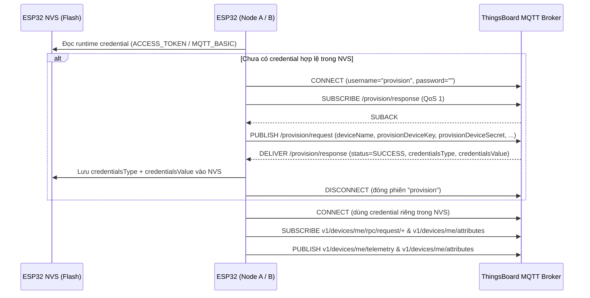

# Đặc tả chuyển đổi giao tiếp ThingsBoard v1 (Node A & Node B)

> **Trạng thái tài liệu:** **`DRAFT / PROPOSED`** *(Bản nháp đặc tả chuyển đổi kiến trúc cho nhánh **Thiết bị / Firmware ESP32** (`node-a`, `node-b`) khi chuyển từ Mosquitto custom MQTT + X.509 mTLS sang **ThingsBoard Device Provisioning & MQTT API**).*  
> **Cảnh báo hiệu lực:** Tài liệu này là **đề xuất kỹ thuật đang chờ cả nhóm thống nhất** (`TB-DEC-01` .. `TB-DEC-09`). Các bước code Wi-Fi, ThingsBoard provisioning, JSON codec, MQTT và TLS trên firmware **CHƯA được triển khai**.  
> **Tài liệu liên quan trong repo:** [contracts/mqtt-v1.md](mqtt-v1.md) *(legacy custom MQTT)*, [contracts/examples/](examples/) *(20 JSON examples gốc giữ nguyên làm mẫu ngữ nghĩa)*, [docs/HANDOFF_BACKEND_ANDROID.md](../docs/HANDOFF_BACKEND_ANDROID.md), [docs/PLAN_PHAN_CUNG_FIRMWARE.md](../docs/PLAN_PHAN_CUNG_FIRMWARE.md), [README.md](../README.md).  
> **Tài liệu chính thức ThingsBoard đối chiếu:** [Device Provisioning](https://thingsboard.io/docs/user-guide/device-provisioning/), [MQTT Device API](https://thingsboard.io/docs/reference/mqtt-api/), [RPC Guide](https://thingsboard.io/docs/user-guide/rpc/), [Device Connectivity Status](https://thingsboard.io/docs/user-guide/device-connectivity-status/).

---

## 1. Bối cảnh chuyển đổi & Nguyên tắc kiến trúc

### 1.1. Hai ESP32 độc lập & Thay đổi lớp xác thực
- **Giữ nguyên mô hình 2 nút độc lập:** `node-a` (`firmware/node-environment`, giám sát môi trường và điều khiển đèn/quạt) và `node-b` (`firmware/node-security`, giám sát an ninh PIR/Reed/Home-Away/Buzzer/SG90) vẫn kết nối trực tiếp tới nền tảng qua Wi-Fi 2,4 GHz, **không qua gateway trung gian** và không nối dây hay ESP-NOW chéo giữa hai node.
- **Giữ nguyên logic biên cục bộ (Edge Rules):** Toàn bộ luật tự động hóa `AUTO`/`MANUAL` hysteresis của Node A và `HOME`/`AWAY` báo động cửa của Node B tiếp tục chạy độc lập trên từng ESP32 kể cả khi mất kết nối ThingsBoard/Internet.
- **Thay đổi xác thực thiết bị:** Nhóm chuyển sang dùng **ThingsBoard Device Provisioning** với cặp `provisionDeviceKey` và `provisionDeviceSecret` thuộc Device Profile thay cho kế hoạch cũ mặc định X.509 mTLS client certificates + Mosquitto ACL.
- **Tài liệu [contracts/mqtt-v1.md](mqtt-v1.md) là legacy:** 12 topic `smarthome/v1/{device_id}/...` trong tài liệu cũ **không** chạy trực tiếp được trên ThingsBoard built-in MQTT API nếu không có broker trung gian hoặc lớp chuyển đổi (adapter). Mọi ánh xạ được phân tích rõ ở Mục 4 và Mục 5.

### 1.2. Nguyên tắc bất khả xâm phạm về danh tính & Credentials
1. **`provisionDeviceKey` / `provisionDeviceSecret` ≠ MQTT Credentials sau đăng ký:**
   - Cặp `provisionDeviceKey` và `provisionDeviceSecret` chỉ là khóa cấp quyền ở tầng **Device Profile** để thiết bị thực hiện bước **onboarding / provisioning** ban đầu.
   - Sau khi provisioning thành công, thiết bị **KHÔNG** dùng cặp key/secret này để publish telemetry, attributes hay subscribe RPC. Mọi phiên vận hành bình thường bắt buộc dùng **`credentialsValue`** riêng đã được ThingsBoard cấp cho từng node.
2. **Danh tính & Credential riêng cho từng node:**
   - `node-a` và `node-b` có thể dùng chung một cặp `provisionDeviceKey`/`provisionDeviceSecret` nếu dùng chung một Device Profile (hoặc 2 Profile riêng nếu cần tách chính sách/Rule Chain — xem `TB-DEC-04`), nhưng **sau provisioning, mỗi node BẮT BUỘC có thực thể Device riêng (`deviceName` riêng) và credential vận hành riêng** (`ACCESS_TOKEN` hoặc `MQTT_BASIC` riêng biệt).
   - Cấm tuyệt đối dùng chung một Access Token hoặc bộ MQTT Basic cho cả `node-a` và `node-b`.
3. **Bảo mật mã nguồn:** Không commit `provisionDeviceKey`, `provisionDeviceSecret`, Access Token thật, mật khẩu MQTT hay Wi-Fi password thật vào Git; nạp qua NVS / file cấu hình ngoài repo bị `.gitignore` chặn.

---

## 2. Quy trình ThingsBoard Device Provisioning (MQTT) & Vòng đời kết nối

Mục này mô tả luồng **MQTT Provisioning** theo tài liệu chính thức ThingsBoard *(phương án dùng HTTP `POST /api/v1/provision` được ghi nhận là lựa chọn mở ở `TB-DEC-02`)*.



### 2.1. Pha 1 — Kết nối Provisioning & Payload trao đổi
1. **Tham số MQTT `CONNECT` khi provisioning:**
   - **Username:** `"provision"` *(giá trị reserved bắt buộc của ThingsBoard MQTT Transport).*
   - **Password:** rỗng.
   - **Topic lắng nghe phản hồi (phải `SUBSCRIBE` TRƯỚC khi `PUBLISH`):** `/provision/response`.
   - **Topic gửi yêu cầu:** `/provision/request`.
2. **Payload gửi lên `/provision/request`:**
   - Trường hợp xin cấp `ACCESS_TOKEN` mặc định theo Device Profile (hoặc không truyền `credentialsType` để server tự xử lý theo cấu hình Profile):
     ```json
     {
       "deviceName": "PLACEHOLDER_DEVICE_NAME",
       "provisionDeviceKey": "PUT_PROVISION_KEY_HERE",
       "provisionDeviceSecret": "PUT_PROVISION_SECRET_HERE"
     }
     ```
   - Trường hợp yêu cầu `MQTT_BASIC` (khi Profile sử dụng `Allow creating new devices` và muốn khai báo bộ định danh riêng):
     ```json
     {
       "deviceName": "PLACEHOLDER_DEVICE_NAME",
       "provisionDeviceKey": "PUT_PROVISION_KEY_HERE",
       "provisionDeviceSecret": "PUT_PROVISION_SECRET_HERE",
       "credentialsType": "MQTT_BASIC",
       "clientId": "PLACEHOLDER_CLIENT_ID",
       "username": "PLACEHOLDER_MQTT_USERNAME",
       "password": "PLACEHOLDER_MQTT_PASSWORD"
     }
     ```
   - *Lưu ý:* Nếu Profile dùng chiến lược **`Check pre-provisioned devices`**, ThingsBoard sẽ kiểm tra thiết bị đã tạo trước theo `deviceName` và trả về credential đã gán sẵn phía server (bỏ qua credential tự khai báo từ thiết bị).
3. **Payload nhận về từ `/provision/response`:**
   - **Thành công với `ACCESS_TOKEN`:**
     ```json
     {
       "status": "SUCCESS",
       "credentialsType": "ACCESS_TOKEN",
       "credentialsValue": "REPLACE_WITH_PROVISIONED_ACCESS_TOKEN"
     }
     ```
   - **Thành công với `MQTT_BASIC`:**
     Theo cấu trúc `ProvisionResponse` của ThingsBoard (`DeviceServiceImpl`), `credentialsValue` trả về là một **chuỗi JSON được serialize** chứa thông tin `BasicMqttCredentials` *(cần xác minh thực tế theo đúng phiên bản CE/Cloud nhóm chọn khi viết parser ở bước code sau)*:
     ```json
     {
       "status": "SUCCESS",
       "credentialsType": "MQTT_BASIC",
       "credentialsValue": "{\"clientId\":\"PLACEHOLDER_CLIENT_ID\",\"userName\":\"PLACEHOLDER_MQTT_USERNAME\",\"password\":\"PLACEHOLDER_MQTT_PASSWORD\"}"
     }
     ```
   - **Thất bại (`FAILURE`):**
     ```json
     {
       "status": "FAILURE",
       "errorMsg": "Provision request is not found!"
     }
     ```
     *Các nguyên nhân phổ biến:* sai `provisionDeviceKey`/`provisionDeviceSecret`, Device Profile chưa bật provisioning, `deviceName` không tồn tại (khi bật `Check pre-provisioned devices`), hoặc thiết bị đã được provision trước đó.

### 2.2. Lưu trữ an toàn, One-shot Provisioning & Reconnect sau Reboot
- **Provisioning là thao tác một lần (one-shot):** Nếu device đã được provision thành công trên ThingsBoard, các lần gửi lại `/provision/request` với cùng `deviceName` sẽ thất bại (trừ khi quản trị viên xóa device với chiến lược tạo mới, hoặc xóa server-side attribute `provisionState` với chiến lược pre-provisioned).
- **Lưu NVS bền vững trên ESP32:** Ngay khi nhận `"status": "SUCCESS"`, firmware (ở task triển khai sau) phải ghi `credentialsType`, `credentialsValue` và `deviceName` vào **NVS (`Preferences`)** trên flash (khuyến nghị đặt tên namespace riêng và xem xét flash/NVS encryption cho bản thương mại), đồng thời đóng ngay phiên MQTT `"provision"`.
- **Reconnect & Reboot:**
  - Khi ESP32 mất mạng rồi kết nối lại, hoặc khởi động lại sau mất điện, thiết bị **đọc credential từ NVS** và kết nối thẳng vào ThingsBoard:
    - Nếu là `ACCESS_TOKEN`: MQTT `username = <credentialsValue>`, `password` rỗng, `clientId` duy nhất cho từng node.
    - Nếu là `MQTT_BASIC`: dùng đúng `clientId`, `userName` (hoặc `username`), `password` đã giải mã từ `credentialsValue`.
  - **Không tự động xóa credential NVS hay gọi lại provisioning một cách mù quáng khi gặp lỗi mạng tạm thời.** Chỉ chuyển về luồng re-provision có kiểm soát khi có lỗi xác thực rõ ràng / thao tác factory reset từ quản trị viên.

---

## 3. Chiến lược Provisioning & Đề xuất ngăn Node lạ (`[PROPOSED]`)

| Tiêu chí so sánh | `Allow creating new devices` | `Check pre-provisioned devices` |
| --- | --- | --- |
| **Cơ chế trên ThingsBoard** | Tự động tạo thực thể Device mới ngay khi nhận `/provision/request` hợp lệ đầu tiên khớp `provisionDeviceKey` + `provisionDeviceSecret`. | Chỉ cho phép provision nếu thực thể Device có `deviceName` tương ứng **đã được tạo sẵn** trên ThingsBoard (qua UI hoặc bulk CSV import). |
| **Xử lý Credentials** | Tạo mới theo cấu hình request (`ACCESS_TOKEN` / `MQTT_BASIC` / X.509) hoặc sinh tự động. | Bỏ qua credential do device đề xuất; cấp lại credential đã cấu hình sẵn trên thực thể Device phía server. |
| **Trường hợp phù hợp** | Sản xuất số lượng lớn chưa biết trước MAC/serial tại thời điểm cấu hình server. | Hệ thống nhỏ cố định node (`node-a`, `node-b`) và bài toán an ninh yêu cầu **chặn thiết bị lạ gia nhập hệ thống**. |
| **Rủi ro nếu lộ Key/Secret** | **Cao:** Bất kỳ máy khách lạ nào trích được `provisionDeviceKey`/`provisionDeviceSecret` đều tự tạo được device giả mới trên ThingsBoard Dashboard/DB. | **Thấp hơn đáng kể:** Device lạ có key/secret nhưng dùng `deviceName` không có trong danh sách tạo trước vẫn bị từ chối; nếu giả mạo `deviceName` đã provision xong thì bị chặn bởi one-shot `provisionState`. |

### Đề xuất ngăn node lạ gia nhập topology (`[PROPOSED]` — Chưa được nhóm duyệt)
Để duy trì mục tiêu an ninh của BT02 (*"Thiết bị lạ không được tự do tham gia hệ thống"*) mà không dùng X.509 mTLS mặc định:
1. **`[PROPOSED]` Ưu tiên chiến lược `Check pre-provisioned devices`:** Quản trị viên/Backend tạo trước đúng 2 thiết bị cho `node-a` và `node-b` trên ThingsBoard rồi mới cho 2 ESP32 boot để claim credential lần đầu.
2. **`[PROPOSED]` Khóa sau khi onboarding (Post-onboarding Lockdown):** Sau khi cả hai node đã provision xong và lưu credential vào NVS trong phòng lab/triển khai, quản trị viên tắt tùy chọn Provisioning trên Device Profile hoặc xoay `provisionDeviceSecret` để key cũ không còn hiệu lực.
3. **`[PROPOSED]` Tách Device Profile hoặc Rule Chain lọc theo `deviceName`:** Sử dụng 2 Device Profile riêng (`node-environment` vs `node-security`) hoặc kiểm tra danh sách thiết bị hợp lệ ở Backend/App trước khi hiển thị lên giao diện Android.

> **Lưu ý:** Các đề xuất trên hiện ở trạng thái **`PROPOSED / CHƯA DUYỆT`**; việc chọn `Check pre-provisioned devices` hay `Allow creating new devices` cần nhóm chốt tại `TB-DEC-04`.

---

## 4. Ánh xạ API MQTT chuẩn ThingsBoard & So sánh với 12 Topic Custom (`mqtt-v1.md`)

### 4.1. Các kênh MQTT chuẩn ThingsBoard (Reference v1)
*(ThingsBoard 3.5+ cũng có topic rút gọn `v2/...` có cùng định dạng payload, nhưng đặc tả này dùng chuẩn tường minh `v1/devices/me/...` để tránh nhầm lẫn khi đối chiếu).*

1. **Telemetry (`v1/devices/me/telemetry`, Device → ThingsBoard, QoS 0/1):**
   - **Gửi trực tiếp (server gán timestamp):**
     ```json
     {
       "temperature_c": 29.4,
       "humidity_pct": 64.0,
       "light_lux": 132.5,
       "valid": true
     }
     ```
   - **Gửi kèm timestamp chính xác hoặc xả hàng đợi backfill theo mảng (`ts` = epoch ms UTC):**
     ```json
     [
       {
         "ts": 1794793200000,
         "values": {
           "temperature_c": 29.4,
           "humidity_pct": 64.0,
           "buffered": true,
           "boot_id": "boot-a-0001-9f2c",
           "seq": 42
         }
       }
     ]
     ```
2. **Attributes (`v1/devices/me/attributes` & `request`/`response`):**
   - **Publish Client Attributes (`Device → TB` trên `v1/devices/me/attributes`):** Gửi thông tin năng lực phần cứng (`meta`) và trạng thái đồng bộ cấu hình/phiên boot.
   - **Subscribe Shared Attributes (`TB → Device` trên `v1/devices/me/attributes`):** Nhận thay đổi cấu hình từ xa (ví dụ bộ ngưỡng `thresholds` trong `AUTO` nếu nhóm chọn đồng bộ qua Shared Attributes thay vì RPC).
   - **Kéo lại Attributes khi reboot/reconnect:** Subscribe `v1/devices/me/attributes/response/+`, sau đó publish lên `v1/devices/me/attributes/request/{requestId}` với `{"clientKeys": "...", "sharedKeys": "..."}`.
3. **Server-side RPC & Response (`v1/devices/me/rpc/request/+` & `v1/devices/me/rpc/response/{requestId}`):**
   - **Thiết bị subscribe:** `v1/devices/me/rpc/request/+` (wildcard `+` nhận `{requestId}` là số nguyên do ThingsBoard cấp cho từng yêu cầu).
   - **Payload server gửi xuống thiết bị:** `{"method": "<ten_lenh>", "params": { ... }}`.
   - **Thiết bị phản hồi (Two-way RPC):** Publish kết quả JSON lên `v1/devices/me/rpc/response/{requestId}` ngay sau khi xử lý xong.
   - *Phân biệt chế độ RPC của ThingsBoard:* **One-way RPC** (không chờ phản hồi), **Two-way RPC** (chờ phản hồi trong timeout HTTP/RPC), và **Persistent RPC** (lưu DB chờ thiết bị online lại kèm `expirationTime` và trạng thái `QUEUED` → `DELIVERED` → `SUCCESSFUL`/`EXPIRED`/`FAILED`).

### 4.2. Bảng đối chiếu 12 Topic Custom cũ (`mqtt-v1.md`) vs ThingsBoard MQTT API

> **Kết luận quan trọng:** Hai tập giao thức **KHÔNG tương thích trực tiếp trên wire**. ThingsBoard built-in MQTT transport chỉ lắng nghe namespace chuẩn (`v1/devices/me/...`, `v2/...`, `/provision/...`), **không** nhận topic `smarthome/v1/{device_id}/...`, không cung cấp MQTT `RETAIN` cho subscriber ngoài theo kiểu Mosquitto, và **không** xử lý MQTT Last Will & Testament (`LWT`) natively như Mosquitto standalone.

| # | Topic Legacy trong [mqtt-v1.md](mqtt-v1.md) | Hướng & Retain cũ | Ánh xạ sang ThingsBoard API | Khoảng trống ngữ nghĩa / Yêu cầu Adapter |
| --- | --- | --- | --- | --- |
| 1 | `smarthome/v1/node-a/telemetry` | Node A → Backend (`retain: false`) | `v1/devices/me/telemetry` (object hoặc mảng `[{"ts", "values"}]`) | Tương thích cao nhất; nhưng mất dedup `(boot_id, seq)` tự động nếu không có Rule Chain / Backend adapter, và `time_synced=false` không gửi được `ts` lịch sử chuẩn. |
| 2 | `smarthome/v1/node-a/command` | Backend → Node A (`retain: false`) | `v1/devices/me/rpc/request/+` *(hoặc Shared Attributes `v1/devices/me/attributes` cho cấu hình)* | ThingsBoard gói lệnh theo `{"method", "params"}`; **không** tự sinh `command_id`, `issued_at`, `expires_at`, `ttl_ms`, `require_time_sync` nếu caller/Backend không tự nhúng vào `params`. |
| 3 | `smarthome/v1/node-a/command-ack` | Node A → Backend (`retain: false`) | `v1/devices/me/rpc/response/{requestId}` **+** `[PROPOSED]` ghi telemetry/attribute `command_ack` | Two-way RPC response chỉ trả về cho lời gọi đồng bộ (hoặc Persistent RPC status), **không** tự ghi thành bảng lịch sử `applied`/`rejected`/`expired`/`duplicate` trong TSDB nếu không thêm bước publish telemetry hoặc Rule Chain lưu lại. |
| 4 | `smarthome/v1/node-a/state` | Node A → Backend/App (`retain: true`) | `v1/devices/me/attributes` (**Client Attributes**) và/hoặc `v1/devices/me/telemetry` | ThingsBoard **không** giữ broker-level `retain: true` để App subscribe thẳng như Mosquitto; App đọc latest client attributes / latest telemetry qua ThingsBoard REST/WS hoặc Backend BFF. |
| 5 | `smarthome/v1/node-a/status` | Node A / LWT → Backend (`retain: true`) | **Không dùng MQTT LWT native.** Dùng ThingsBoard **Device State Service** (`active`, `lastConnectTime`, `lastDisconnectTime`, `inactivityTimeout`) + telemetry/attributes (`rssi_dbm`, `free_heap`, `reconnect_count`). | Cần cấu hình server attribute `inactivityTimeout` (ms) phù hợp (~15–20s thay cho mặc định 600s) và Rule Engine xử lý `Connect`/`Disconnect`/`Inactivity` event thay cho LWT `lwt_unexpected_disconnect`. |
| 6 | `smarthome/v1/node-a/meta` | Node A → Backend (`retain: true` `[PROPOSED]`) | `v1/devices/me/attributes` (**Client Attributes**: `role`, `board`, `build_env`, `firmware_version`, `sensors`, `actuators`, `capabilities`) | Gửi sau mỗi lần connect; không dùng làm cơ chế tự tạo device mới. |
| 7 | `smarthome/v1/node-b/event` | Node B → Backend (`retain: false`) | `v1/devices/me/telemetry` (`event_type`, `security_mode`, `door_open`, `motion_detected`, `alarm_on`, `trigger_source`, `buffered`, `boot_id`, `seq`) | Rule Chain của ThingsBoard phải phân tích `event_type == "alarm_triggered"` để tạo ThingsBoard Alarm hoặc đẩy notification tới Backend/Android `≤ 1s`. |
| 8 | `smarthome/v1/node-b/command` | Backend → Node B (`retain: false`) | `v1/devices/me/rpc/request/+` | Giống #2; lệnh `security_mode`, `servo`, `alarm` phải map qua `method`/`params` và vẫn qua `CommandGuard` + kiểm tra dải an toàn góc SG90 trên ESP32. |
| 9 | `smarthome/v1/node-b/command-ack` | Node B → Backend (`retain: false`) | `v1/devices/me/rpc/response/{requestId}` **+** `[PROPOSED]` telemetry/attribute `command_ack` | Giống #3; đặc biệt quan trọng để ghi nhận lý do `servo_angle_out_of_safe_range` hoặc `clock_unsynced_cannot_verify_expiry`. |
| 10 | `smarthome/v1/node-b/state` | Node B → Backend/App (`retain: true`) | `v1/devices/me/attributes` (**Client Attributes**) và/hoặc `v1/devices/me/telemetry` | Giống #4; App luôn đối chiếu `reported state` (`security_mode`, `door_open`, `alarm_on`, `servo_angle`), không cập nhật lạc quan. |
| 11 | `smarthome/v1/node-b/status` | Node B / LWT → Backend (`retain: true`) | ThingsBoard **Device State Service** + telemetry/attributes chẩn đoán | Giống #5; phải kiểm tra hành vi rớt mạng đột ngột với `inactivityTimeout` + MQTT Keep-Alive. |
| 12 | `smarthome/v1/node-b/meta` | Node B → Backend (`retain: true` `[PROPOSED]`) | `v1/devices/me/attributes` (**Client Attributes**) | Giống #6. |

---

## 5. Adapter, Rule Chain & Backend cho các trường nội bộ cũ

Firmware Node A và Node B hiện tại đã xây dựng và unit-test các module thuần C++ (`command_guard`, `utc_time`, `automation`/`security`) theo hợp đồng v1. Khi tích hợp với ThingsBoard, **không được ngộ nhận rằng ThingsBoard tự hiểu hoặc tự duy trì các trường nội bộ sau**:

| Trường / Cơ chế nội bộ cũ | ThingsBoard có tự hỗ trợ không? | Trách nhiệm Adapter / Rule Chain / Backend |
| --- | --- | --- |
| **`command_id`** (8–64 ký tự `[A-Za-z0-9_-]`) & dedup 24 lệnh | **Không.** ThingsBoard chỉ sinh `{requestId}` số nguyên cho mỗi lần gửi RPC và tự tăng lại mỗi phiên server/request; không tương đương `command_id` nghiệm thu/idempotency của App. | Backend/Caller phải nhúng `"command_id"` trong `params` của RPC (hoặc Rule Chain tạo nếu gọi từ ThingsBoard Widget), và Adapter trên ESP32 ánh xạ vào `CommandGuard` để phát hiện `"duplicate"`. |
| **`issued_at`, `expires_at`, `ttl_ms`, `require_time_sync`** | **Không tự nhúng vào JSON RPC.** Persistent RPC có `expirationTime` ở phía broker/DB ThingsBoard, nhưng payload MQTT gửi xuống `rpc/request/{id}` mặc định chỉ gồm `{"method", "params"}`. | Để giữ nguyên bảo vệ chống lệnh cũ/chưa đồng bộ giờ của `CommandGuard` + `UtcParser` (chỉ nhận đúng 20 ký tự `"YYYY-MM-DDTHH:MM:SSZ"`, **từ chối `.sssZ`** của `Date.toISOString()`), Backend/ThingsBoard Rule Chain phải điền đúng `"issued_at"`, `"expires_at"` (dạng `"YYYY-MM-DDTHH:MM:SSZ"`), `"ttl_ms"`, `"require_time_sync"` vào `params`. |
| **`boot_id` & `seq`** | **Không tự dedup theo `(device_id, boot_id, seq)`.** ThingsBoard ghi đè theo khóa `(entity_id, key, ts)` trong TSDB. Nếu 2 gói dùng server-side timestamp khác nhau, QoS 1 retransmit hoặc backfill trùng sẽ tạo nhiều dòng có `ts` khác nhau. | Rule Chain (ví dụ Deduplication node / Script / TBEL) hoặc Backend Consumer phải đối chiếu `(device_id, boot_id, seq)` trước khi lưu lịch sử dài hạn hoặc tránh nhân đôi sự kiện an ninh. |
| **`command-ack` (`applied`/`rejected`/`expired`/`duplicate`)** | **Chỉ một phần qua two-way RPC response.** Nếu là Persistent RPC khi node đang offline hoặc lệnh bị từ chối với lý do chi tiết (`clock_unsynced_cannot_verify_expiry`), HTTP two-way ban đầu đã timeout hoặc chỉ thấy trạng thái chung `EXPIRED`/`FAILED`. | Thiết bị trả `rpc/response/{requestId}` cho two-way RPC **đồng thời** khuyến nghị (`[PROPOSED]`) đẩy bản ghi `command_ack` về `v1/devices/me/telemetry` (hoặc Rule Chain chuyển tiếp RPC response vào telemetry/audit log) để Backend/App hiển thị lịch sử trạng thái lệnh chính xác. |
| **`status` (`online`/`offline` LWT)** | **Không hỗ trợ LWT native trên ThingsBoard built-in MQTT transport.** | Dùng Device State Service (`active`, `lastDisconnectTime`, `inactivityTimeout`) + Rule Engine xử lý `Connect`/`Disconnect`/`Inactivity`; kết hợp Node publish `online: false` qua attribute/telemetry nếu có graceful shutdown. |
| **Offline Backfill (`buffered: true`, `time_synced: false`, `timestamp: null`)** | **Có hỗ trợ mảng `[{"ts": <epoch_ms>, "values": {...}}]` khi có `ts` thật.** Nếu thiếu `ts` (`time_synced == false`), ThingsBoard mặc định gắn **thời gian server lúc nhận** cho toàn bộ lô backfill → làm sai thứ tự thời gian thực tế lúc mất mạng! | Khi `time_synced == true`: firmware đóng gói mảng `[{"ts": epoch_ms, "values": ...}]` để ThingsBoard lưu đúng thời điểm đo. Khi `time_synced == false`: gửi flat JSON kèm `buffered: true`, `uptime_ms`, `boot_id`, `seq` và Rule Chain / Backend adapter gắn cờ `timestamp_source = "server_fallback"` (hoặc nội suy tương đối theo `uptime_ms` cùng `boot_id`). |

### Ví dụ minh họa cầu nối RPC Envelope (`[PROPOSED]` — cần chốt ở `TB-DEC-07`/`TB-DEC-09`)
- **Downlink trên `v1/devices/me/rpc/request/42`:**
  ```json
  {
    "method": "dispatch_command",
    "params": {
      "schema_version": 1,
      "command_id": "cmd-nodeb-20261116-0001",
      "device_id": "node-b",
      "target": "security_mode",
      "action": "set",
      "value": "AWAY",
      "issued_at": "2026-11-16T01:40:00Z",
      "expires_at": "2026-11-16T01:40:30Z",
      "ttl_ms": 30000,
      "require_time_sync": true
    }
  }
  ```
- **Uplink trên `v1/devices/me/rpc/response/42`:**
  ```json
  {
    "schema_version": 1,
    "device_id": "node-b",
    "command_id": "cmd-nodeb-20261116-0001",
    "status": "applied",
    "reason": null,
    "applied_mode": "AWAY",
    "executed_at": "2026-11-16T01:40:02Z",
    "time_synced": true,
    "uptime_ms": 147120
  }
  ```

---

## 6. Tổng hợp các quyết định còn mở (`TB-DEC-01` .. `TB-DEC-09`) `[PROPOSED / OPEN]`

> **Tất cả 9 hạng mục dưới đây hiện ở trạng thái `CHƯA ĐƯỢC PHÊ DUYỆT` (`OPEN`).** Nhóm cần thảo luận và xác nhận trước khi bước vào các task viết code mạng, provisioning và JSON codec cho ESP32, Backend và Android.

| Mã | Vấn đề cần chốt | Các phương án & Tác động | Đề xuất tham khảo (chưa chốt) | Chủ thể quyết định |
| --- | --- | --- | --- | --- |
| **`TB-DEC-01`** | **Nền tảng ThingsBoard: CE / PE hay ThingsBoard Cloud** | **CE (Docker local/VPS):** tự chủ hoàn toàn PostgreSQL, rule chain, `inactivityTimeout`, Wokwi LAN/Docker, không giới hạn DPSD cloud; **Cloud:** không cần dựng server nhưng bị ràng buộc quota/DPSD/Persistent RPC tùy gói và phụ thuộc Internet khi chạy mạch thật/Wokwi. **PE:** cần license trả phí. | Ưu tiên **ThingsBoard CE (Docker)** nếu cần kiểm soát DB 7 ngày & mạng LAN lab, hoặc **Cloud** nếu cả nhóm đã có tài khoản/tenant chung. | Cả nhóm (Backend chủ trì hạ tầng) |
| **`TB-DEC-02`** | **Kênh Provisioning: MQTT (`/provision/request`) hay HTTP (`POST /api/v1/provision`)** | **MQTT:** tận dụng cùng thư viện MQTT + TLS trên ESP32, không phải giữ thêm HTTP client song song. **HTTP:** tách biệt hẳn pha bootstrap với kết nối MQTT chính, dễ debug curl/Postman. | Ưu tiên **MQTT Provisioning** để gọn RAM/Flash trên ESP32. | Firmware + Backend |
| **`TB-DEC-03`** | **Loại Credential cấp sau Provisioning: `ACCESS_TOKEN` hay `MQTT_BASIC`** | **`ACCESS_TOKEN`:** gọn nhẹ, chỉ 1 chuỗi token làm MQTT `username`, ít điểm sai khi parse `credentialsValue`. **`MQTT_BASIC`:** cho phép có cả `clientId`, `userName`, `password` riêng nhưng `credentialsValue` trả về dạng JSON serialized phức tạp hơn. | Ưu tiên **`ACCESS_TOKEN`** trừ khi Backend yêu cầu password MQTT riêng. | Firmware + Backend |
| **`TB-DEC-04`** | **Chiến lược chống node lạ & Số lượng Device Profile (`Allow creating new devices` vs `Check pre-provisioned devices`)** | **`Check pre-provisioned`:** chặn hoàn toàn node có `deviceName` lạ ngay cả khi lộ profile key/secret. **`Allow creating`:** linh hoạt nhưng rủi ro node lạ tự sinh device. Kết hợp quyết định 1 Profile chung hay 2 Profile (`env`/`sec`). | Đề xuất **`Check pre-provisioned devices`** + tách 2 Device Profile (hoặc khóa provisioning sau onboarding). | Cả nhóm |
| **`TB-DEC-05`** | **Quy ước đặt `deviceName` trên ThingsBoard & mapping với `device_id` logic** | Trên ThingsBoard tenant dùng chung (nhất là Cloud), tên `"node-a"` rất dễ trùng với người dùng khác trong tenant/cluster nếu không có tiền tố; nhưng `CommandGuard` trong firmware hiện so khớp `device_id` (`"node-a"` / `"node-b"`). | Dùng `deviceName` duy nhất trên TB (ví dụ `nhom9-smarthome-node-a` hoặc `node-a-<mac4>`), và tách rõ với `device_id` nghiệp vụ (hoặc truyền `device_id` qua client attribute / cấu hình đồng bộ). | Firmware + Backend |
| **`TB-DEC-06`** | **TLS (`8883` vs `1883` LAN/SIM) & Đồng bộ đồng hồ UTC (SNTP)** | `REAL` qua Internet/Cloud **bắt buộc TLS (`8883`) + pin Root CA** (cấm `setInsecure()`). Nếu test `SIM` hoặc CE Docker trong LAN không Internet, cần chốt Lab CA hay TCP `1883` loopback/LAN, và nguồn **SNTP/local NTP** để verify hạn cert + `UtcParser` (`expires_at`) + `ts` backfill. | `REAL`: TLS `8883` + pin CA + SNTP (local NTP fallback nếu lab mất Internet). `SIM`: thỏa thuận Lab CA hoặc `1883` nội bộ cô lập. | Firmware + Backend |
| **`TB-DEC-07`** | **Kiến trúc Backend & Android (`Backend BFF` hay `Android gọi thẳng ThingsBoard REST/WS`)** | **Giữ Node.js + PostgreSQL BFF:** giữ nguyên lớp adapter gói RPC `command_id`/`issued_at`/`expires_at` (`"YYYY-MM-DDTHH:MM:SSZ"`), dedup `(boot_id, seq)`, giữ DB 7 ngày riêng, Android dùng API nhóm tự thiết kế. **Android gọi thẳng ThingsBoard:** giảm code server Node.js nhưng phải dùng JWT/REST/WS của ThingsBoard và phụ thuộc khả năng Rule Chain để giữ ngữ nghĩa lệnh/backfill. | Cần Backend & Android thống nhất rõ trước khi viết Adapter/API. | Backend + Android |
| **`TB-DEC-08`** | **Chính sách lưu trữ lịch sử tối thiểu 7 ngày (BT02)** | Xác định rõ dữ liệu ≥ 7 ngày nằm ở **ThingsBoard TSDB** (PostgreSQL/Cassandra với TTL ≥ 7 ngày, kiểm tra giới hạn Cloud DPSD nếu dùng Cloud) hay **PostgreSQL của Backend BFF** đồng bộ từ ThingsBoard. | Chốt theo kết quả của `TB-DEC-01` và `TB-DEC-07`. | Backend + Android |
| **`TB-DEC-09`** | **Chuyển hóa các điểm mở `PROP-01`..`PROP-08` từ [mqtt-v1.md](mqtt-v1.md)** | Đặc biệt: mapping `command-ack` (`PROP-01`), rule lệnh khi `time_synced=false` (`PROP-02`), cập nhật `thresholds` qua RPC vs Shared Attributes (`PROP-05`), `HOME_AWAY_SWITCH`/`PIR` (`PROP-06`), `light_lux: null` + `LDR_SIM` (`PROP-07`). | Bảo toàn toàn bộ quy tắc an toàn firmware (`null` khi lỗi cảm biến, không tự bật `PIR` báo động nếu chưa duyệt, từ chối servo ngoài biên an toàn). | Cả nhóm |

---

## 7. Tài liệu tham chiếu chính thức ThingsBoard

- ThingsBoard Device Provisioning: `https://thingsboard.io/docs/user-guide/device-provisioning/`
- ThingsBoard MQTT Device API Reference: `https://thingsboard.io/docs/reference/mqtt-api/`
- ThingsBoard RPC Capabilities (One-way, Two-way, Persistent): `https://thingsboard.io/docs/user-guide/rpc/`
- ThingsBoard Device Connectivity Status (`active`, `inactivityTimeout`, `Connect`/`Disconnect`/`Inactivity`): `https://thingsboard.io/docs/user-guide/device-connectivity-status/`
